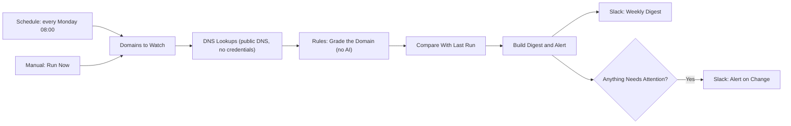

# Sender Domain Health: SPF, DKIM & DMARC Check and Monitor

An **n8n** workflow that reads the DNS records every B2B sender depends on, grades them with fixed rules, and alerts when they change. It needs no credentials for the checks: it reads what any mailbox provider reads, from public DNS.

**[Check any domain live](https://errer441122.github.io/sender-domain-health/)** · **[Download the workflow](workflows/sender-domain-health.n8n.json)** · **[Every rule in plain words](docs/rules.md)**

[](https://errer441122.github.io/sender-domain-health/)

> **What is real and what is not:** the workflow was imported and executed in n8n 2.48.7 on 21 November 2026 against live DNS for 23 real domains: my own two, one parked domain, and 20 Italian B2B companies. Every number below comes from that run. Not connected: Slack (the two Slack nodes were swapped for placeholders, so the digest and alert texts are real but were never posted to a workspace).

---

## The Business Problem

A B2B company sends email from many tools at once: mailboxes, CRM, marketing automation, helpdesk, HR, invoicing. Three DNS records decide whether that email is trusted, and they break quietly:

- **Fake email in the company's name still gets delivered.** With DMARC left at `p=none`, providers are only asked for reports. Fake invoices and payment-change requests sent as the company are not stopped by DMARC.
- **Every new tool makes SPF more fragile.** Each tool adds an `include` to the SPF record. Past 10 DNS lookups SPF stops working for every message, and nothing warns you.
- **A dashboard can say "verified" when nothing is configured.** That happened to me (see [the trap](#the-trap-that-started-this)).
- **DNS gets edited by other people.** IT, an agency or a new vendor changes a record, and marketing finds out when open rates drop.

---

## How It Works



1. **Read.** For each domain: SPF with every `include` followed, DMARC (a subdomain inherits from the closest parent domain that has a record), MX, and the DKIM selectors you list.
2. **Grade.** Fixed rules, no AI. Each finding carries the issue, what it means in plain words, and the fix. `FAIL` = a blocker, `WARN` = warnings only, `PASS` = nothing to fix, `ERROR` = DNS could not be read (never reported as a missing record).
3. **Compare.** The last verdict of each domain is remembered, so a quiet week stays quiet.
4. **Tell.** A digest on every run. An alert only when a domain gets worse, fails on its first check, or has its records edited.

No AI is used anywhere: every check has one right answer, so code gives the same verdict every time. Every finding is listed in [`docs/rules.md`](docs/rules.md).

The [live page](https://errer441122.github.io/sender-domain-health/) runs the same two code nodes (`DNS Lookups` and `Rules`) in the browser, read from the workflow file, so the page and the workflow cannot drift apart.

---

## Results From the Real Run (21 November 2026)

### My own domains, and the trap

| Domain | Verdict | What the workflow found |
| --- | --- | --- |
| `negozio-online.org` (root, mailboxes) | **WARN** | DMARC in monitoring mode (`p=none`) and no report address: a policy nobody reads |
| `send.negozio-online.org` (marketing subdomain, delegated to the email tool) | **WARN** | DMARC inherited from the root; DKIM keys `s1` and `s2` resolve; no MX, so replies to that domain are lost |
| `mionegozio.com` (someone else's parked domain) | **FAIL** | A TXT record answers at `_dmarc` but it is `v=spf1 -all`, not a DMARC policy |

My own domain does not pass cleanly. Fixing it (a report address, then `p=quarantine`) is the next entry in this repo, and the workflow will show the change. Full verdicts: [`data/own-domains-2026-11-21.json`](data/own-domains-2026-11-21.json).

### 20 Italian B2B companies

Six software and fourteen industrial companies, picked by hand. Data: [`data/italian-b2b-sample-2026-11-21.csv`](data/italian-b2b-sample-2026-11-21.csv).

| Finding | Companies |
| --- | ---: |
| Publish both SPF and DMARC | 20 of 20 |
| DMARC at `reject` | 9 |
| DMARC at `quarantine` | 4 |
| DMARC in monitoring mode only (`p=none`) | **7** |
| SPF past the 10-lookup limit (12 lookups: SPF is broken) | **1** |
| SPF at 9 or 10 lookups (one tool away from breaking) | **4** |
| Enforced DMARC that leaves subdomains open (`sp=none`) | 2 |
| Overall: PASS / WARN / FAIL | 9 / 10 / 1 |

The SPF records also show which tools send for each company: Microsoft 365 in 13, MailUp in 5, Amazon SES in 5, HubSpot in 4, Salesforce in 4. Inbound email is filtered by Microsoft 365 for 9 and by Proofpoint for 4.

**How to read it:** company names are withheld, because the point is the method and any domain can be checked on the live page. It is a hand-picked sample of well-known companies, not a market statistic, and smaller companies were not measured. DKIM was not checked for the sample: a key cannot be found from outside without its selector.

### What n8n did

| Run | Domains | New | Unchanged | Alert |
| --- | ---: | ---: | ---: | --- |
| 1 | 23 | 23 | 0 | fired, for the 2 failing domains |
| 2 | 23 | 0 | 23 | not fired |

A worse verdict or an edited record could not be produced on real DNS on demand; those paths are covered by [`tests/workflow.test.mjs`](tests/workflow.test.mjs), which runs the workflow's own nodes against canned DNS answers in CI.

---

## The Trap That Started This

While authenticating a real sending domain on a real email tool, the dashboard showed the `_dmarc` record as **Verified** on a domain where nothing was configured. The domain was someone else's, parked on a resale marketplace whose zone answers every TXT question with the same line:

```
$ nslookup -type=TXT _dmarc.mionegozio.com
_dmarc.mionegozio.com   text = "v=spf1 -all"
```

A wildcard answered, and the check went green. Since then I verify records in public DNS, never on a dashboard tick. This workflow is that habit, automated: the rule `dmarc_not_a_policy` catches exactly this case, and the parked domain still triggers it today.

The full story, with the second trap (a domain can be *Verified* and still not *Active*), is in [`docs/field-notes/klaviyo-shopify-field-notes.md`](docs/field-notes/klaviyo-shopify-field-notes.md).

---

## Use It

1. In n8n: **Workflows → Import from File** → [`workflows/sender-domain-health.n8n.json`](workflows/sender-domain-health.n8n.json).
2. Open the node **Domains to Watch** and replace the two rows with your sending domains. Add `dkim_selectors` if you know them (the `s=` value in the `DKIM-Signature` header of a real email).
3. Click **Execute workflow**. The checks run with no credentials.
4. For the messages, connect Slack to the two Slack nodes (`#email-health`, `#martech-alerts`), or replace them with email. Import [`workflows/error-notifier.n8n.json`](workflows/error-notifier.n8n.json) and select it under **Settings → Error Workflow**.

To watch many domains, for example an agency's clients, swap **Domains to Watch** for a Google Sheets read with the same columns: `domain`, `label`, `dkim_selectors`.

## What It Cannot See

- **Inbox placement.** DNS says who may send. Reputation, content and complaints decide the rest.
- **DKIM without a selector.** Keys are found only by selector name.
- **SPF on the return-path.** Email tools often send with their own hidden bounce address; the workflow reads the domain you list.
- **Domains you did not list.** A tool sending from a subdomain nobody told you about stays invisible until DMARC reports show it.
- **Change memory lives in one n8n instance** (workflow static data), and only scheduled runs keep it.

## Where This Came From

This repository began as a hands-on lab on a real Klaviyo account, a Shopify development store and a real sending domain. Those notes stay in [`docs/field-notes/`](docs/field-notes/) as the record of that setup (flows, consent, deliverability, what broke). The earlier version of the repo, with its email pre-send QA workflow, is kept under the git tag `klaviyo-lab`.

## Repository Structure

| Path | Content |
| --- | --- |
| `workflows/sender-domain-health.n8n.json` | The 10-node n8n workflow: lookups, rules, change memory, digest and alert |
| `workflows/error-notifier.n8n.json` | Standalone 2-node Error Workflow routing failed runs to `#martech-alerts` |
| `docs/rules.md` | Every finding in plain words: what it says, what it means, how to fix it |
| `data/own-domains-2026-11-21.json` | Full verdicts for my two domains and the parked trap |
| `data/italian-b2b-sample-2026-11-21.csv` | The 20-company sample, names withheld |
| `tests/workflow.test.mjs` | The workflow's nodes run against canned DNS answers (also in CI) |
| `docs/field-notes/` | Notes from the Klaviyo, Shopify and DNS lab this started from |
| `docs/index.html` | The live checker and showcase page (GitHub Pages) |

## License

MIT. See [LICENSE](LICENSE).
