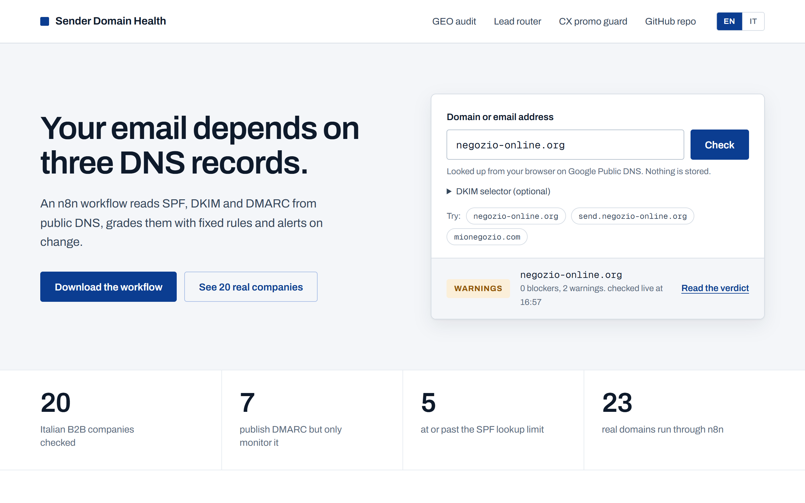
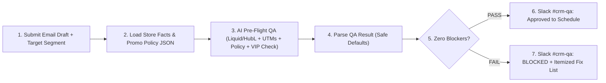

# CRM Governance, Deliverability, VIP Margin Rules & AI Pre-Send QA

An operational playbook and visual **n8n + AI Pre-Flight QA** workflow for **Klaviyo, HubSpot, and Shopify** teams — built directly from real platform failure modes discovered during hands-on DNS, Double Opt-In, and lifecycle flow execution.

**[Explore the interactive showcase & field notes](https://errer441122.github.io/lifecycle-automation-lab/)** · **[Download n8n QA blueprint](workflows/ai-email-preflight-qa.n8n.json)** · **[Error Notifier](workflows/error-notifier.n8n.json)**

> **Live Testing & Scope:** DNS authentication (`send.negozio-online.org` on Cloudflare), Double Opt-In consent flows, Abandoned Cart, and Win-Back flows were built and fired **live** on a real Klaviyo Free + Shopify Dev Store setup (documented in `docs/field-notes/` with zero fabricated conversion rates). The 7-node n8n AI Pre-Flight QA gate + standalone Error Workflow audits campaign drafts against `config/store-facts-and-promo-policy.json` and outputs itemized fix lists to Slack `#crm-qa`.

---

## 4 Real Platform Failure Modes Caught Hands-On

These are not theoretical checklist items — every rule in this repository comes from real failures encountered while authenticating a real sending domain (`send.negozio-online.org` on Cloudflare) and running live flows in Klaviyo + Shopify (full write-up in [`docs/field-notes/klaviyo-shopify-field-notes.md`](docs/field-notes/klaviyo-shopify-field-notes.md)):

1. **Smart Sending silently dropped the 1st abandoned-cart email:** A welcome email had gone out ~5 hours earlier, so Klaviyo skipped step 2.1 with zero errors in standard reports (only visible under *Recipient Activity → Skipped*). **Operational rule:** turn Smart Sending **OFF** on high-intent abandoned-cart steps; keep it **ON** for promotional newsletters.
2. **Double Opt-In on a Klaviyo list did NOT protect the list:** A signup via Shopify's native newsletter checkbox bypassed the confirmation email and landed as `SUBSCRIBED` in 86 milliseconds. **Operational rule:** isolate flow-triggered lists from third-party checkbox syncs and audit `consent_source` + `consent_timestamp` continuously (GDPR Art. 7(1)).
3. **A green "Verified" DNS badge was a parked-domain wildcard:** An Afternic wildcard TXT (`v=spf1 -all`) made Klaviyo mark `_dmarc` green even though nothing was configured, and a later **Verified** domain still had to be manually **Activated**. **Operational rule:** verify SPF/DKIM/DMARC via public DNS (`nslookup`) and raw headers — never trust a dashboard tick alone.
4. **Well-written copy promised things the store could not deliver:** Drafts passed manual proofreading while claiming *"48h shipping"* (unpublished at checkout) and *"valid 14 days"* on a static coupon code, plus empty Liquid fallbacks (`Ciao {{ first_name|default:'' }},` rendering `"Ciao ,"`). **Operational fix:** automated **AI Copy-vs-Policy & VIP Margin Pre-Flight QA** before every send.

---

## Automated Pre-Send QA Workflow (`workflows/ai-email-preflight-qa.n8n.json`)

*Global safety net:* link [`workflows/error-notifier.n8n.json`](workflows/error-notifier.n8n.json) under **Settings → Error Workflow** in n8n so any API failure alerts `#martech-alerts`.

### What the QA Gate Checks Before Launch
- **Personalization & Syntax:** Missing or empty fallbacks in both **Klaviyo Liquid** (`{{ first_name }}`) and **HubSpot HubL** (`{{ contact.firstname }}`).
- **GA4 UTM Hygiene:** Required lowercase `utm_source`, `utm_medium=email`, `utm_campaign` on all commercial links.
- **Copy vs. Store Policy Truth Table:** Cross-checks claims against [`config/store-facts-and-promo-policy.json`](config/store-facts-and-promo-policy.json) so emails never promise unsupported shipping SLAs or incoherent coupon terms.
- **VIP Margin Guardrail:** Automatically flags promotional discounts when `VIP / Champions`, `Full-Price Repeat Buyers`, `Purchased Last 14 Days`, or `Active CX Hold` are missing from the campaign exclusions ([`docs/vip-margin-protection-rules.md`](docs/vip-margin-protection-rules.md)).
- **Mobile & Deliverability Basics:** Subject ≤50 chars, non-duplicate preheader, mandatory unsubscribe token, image `alt` text.

---

## Repository Structure

| Path | Content |
| --- | --- |
| `workflows/ai-email-preflight-qa.n8n.json` | 1-click importable 7-node n8n Pre-Flight QA & itemized Slack approval workflow |
| `workflows/error-notifier.n8n.json` | Standalone 2-node Error Workflow routing execution failures to `#martech-alerts` |
| `config/store-facts-and-promo-policy.json` | Store truth table (returns, shipping SLA, promo rules, VIP exclusions, GA4 UTMs) |
| `prompts/email-policy-qa-prompt.md` | Structured AI QA prompt (`temperature = 0.0`) & real before/after example |
| `docs/vip-margin-protection-rules.md` | Full-price vs. discount eligibility decision matrix for Klaviyo & HubSpot |
| `docs/sop-pre-send-qa-checklist.md` | 1-page Pre-Send QA, GDPR Art. 7(1) & Deliverability SOP |
| `docs/field-notes/` | Complete hands-on Klaviyo, Shopify & DNS field notes (`klaviyo-shopify-field-notes.md`, `flows.md`, `consent.md`, `deliverability.md`, `email-copy.md`) |
| `assets/` | Screenshots from the live Klaviyo flows, exit filters, Double Opt-In setup & DNS records |
| `docs/index.html` | Interactive showcase & Pre-Send QA checklist (GitHub Pages) |

> *Honesty note:* The Klaviyo account, flows, and Cloudflare DNS records (`send.negozio-online.org`) documented in `docs/field-notes/` are real, tested on a Shopify development store with no real customers — which is why no open rates or revenue benchmarks are claimed anywhere in this repository.

## License

MIT. See [LICENSE](LICENSE).
