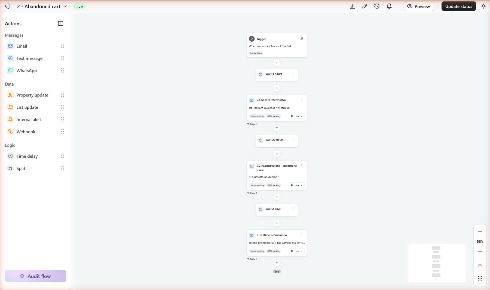
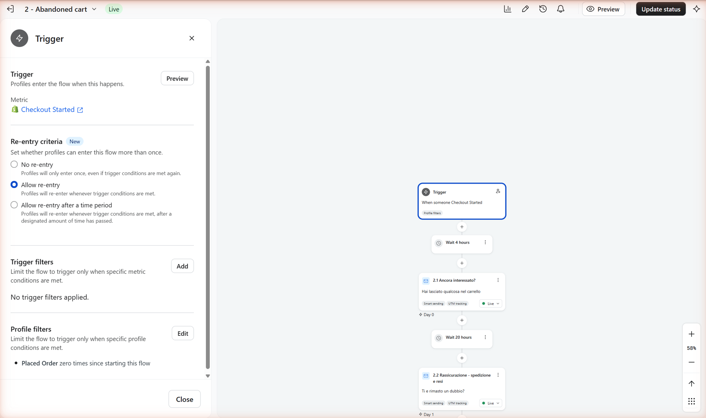
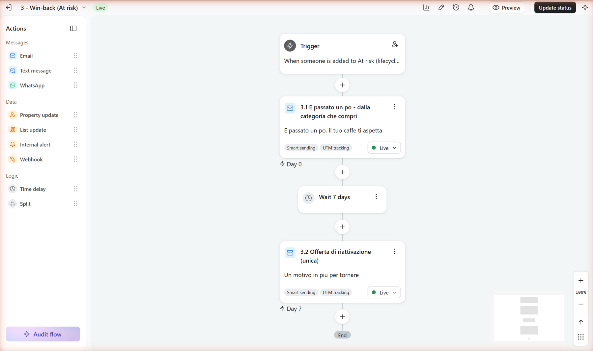

# Lifecycle Automation Lab

Three Klaviyo flows on a Shopify development store: welcome with double opt-in,
abandoned cart and win-back. The win-back is triggered by lifecycle stages that
a Python script computes from order history and writes onto the Klaviyo profile.

## What is real and what is not

| Real | Not real |
| --- | --- |
| A Klaviyo account with three live flows and seven emails | The store is a Shopify development store: password-protected, with no real customers |
| A sending domain I authenticated myself (NS delegation, DKIM, DMARC), checked with public DNS queries | The orders in it were seeded by me |
| A double opt-in list, and a sync script that refuses to act on a profile without consent | One subscriber, three delivered emails, no clicks and no sales |

So this repository shows that the mechanism works end to end. It does not show
performance: there is no open rate, click rate or revenue worth reporting, and
[the results](reports/results.md) report counts, never rates.

## What I found by running it

These only showed up because the flows were actually sent, not just drawn.

1. **Smart Sending skipped the first abandoned-cart email.** A welcome email
   had gone out five hours earlier, so Klaviyo suppressed the cart email. The
   API showed no send event and no skip event. One screen in the ESP names the
   reason. The next email in the same flow went out a day later, once the window
   had passed.
2. **Double opt-in on a list does not protect the list.** A sign-up through
   Shopify's own newsletter field was written into Klaviyo as `SUBSCRIBED` 86 ms
   after the webhook, with no confirmation email. The setting only protects the
   path that goes through the form.
3. **A green "Verified" was someone else's DNS record.** The first domain I
   tried was parked on a resale marketplace whose wildcard answered every TXT
   query. Klaviyo marked DMARC as verified and nothing had been configured.
   Since then I check DNS with `nslookup`, not with the vendor's status column.

One claim is still unproven: the abandoned-cart exit condition has not been
observed stopping a send, because the one test run against it was confounded
by Smart Sending. The results name the experiment that would settle it.

Full write-up, including what else broke: [`reports/results.md`](reports/results.md).

## The flows

| # | Flow | Trigger | Steps |
| --- | --- | --- | --- |
| 1 | Welcome | Added to the double opt-in list, so only after confirmation | Day 0 → wait 3 days → Day 3 |
| 2 | Abandoned cart | `Checkout Started`, with the filter *Placed Order zero times since starting this flow* re-checked before every send | 4h → email → 20h → email → 2 days → email |
| 3 | Win-back | Entry into the `At risk` segment, which reads a profile property written by [`src/sync_klaviyo.py`](src/sync_klaviyo.py) | Day 0 → wait 7 days → Day 7 |

Specification and the reason for each delay: [`docs/flows.md`](docs/flows.md).
Consent design: [`docs/consent.md`](docs/consent.md).
Domain authentication: [`docs/deliverability.md`](docs/deliverability.md).







More screenshots (welcome flow, segment, double opt-in setting, DNS answers,
Shopify admin) are in [`assets/`](assets).

## From analysis to ESP segment

The lifecycle model does not live in the ESP. It is computed from order history
and pushed onto the profile as a property. A Klaviyo segment reads the property
and the segment triggers the flow.

```
orders export  ─┐
                ├─►  sync_klaviyo.py  ─►  profile property        ─►  Klaviyo segment  ─►  flow
consent export ─┘    (hard consent gate)   lifecycle_stage="At risk"   "At risk"          win-back
```

| Stage | Rule |
| --- | --- |
| New | last order ≤ 90 days ago, 1 order |
| Repeat | last order ≤ 90 days ago, ≥ 2 orders |
| At risk | last order 91–180 days ago |
| Dormant | last order 181–365 days ago |
| Churned | last order > 365 days ago |

The thresholds are the same as in my
[CRM retention analysis](https://github.com/errer441122/digital-campaign-performance-dashboard).

The script never grants consent. It only updates profiles that have already
opted in, and it reports everyone it held back.

## Run it

Python standard library only.

```bash
python -m unittest discover -s tests
```

```bash
python src/sync_klaviyo.py --as-of 2026-06-01
```

That is a dry run on the example data in `data/`: it prints who would be synced
and who is suppressed, and sends nothing. A live sync needs `KLAVIYO_API_KEY` in
the environment and the `--live` flag.

The seven emails are generated from this repo, because Klaviyo's API does not
let you update a flow message's content. The HTML is pasted in by hand once, and
this command (read-only API key needed) checks that what is live still matches
the repo:

```bash
python src/build_templates.py --verify
```

## Boundaries

- No purchased, scraped or imported lists. The only recipient confirmed through
  double opt-in.
- The example CSVs use `example.com` addresses, which cannot receive mail.
- The numbers are a snapshot from 31 August 2026.

## How I built this

Built with AI coding assistants as a pair programmer: they drafted most of the
code and docs. My part: setting up and running the Klaviyo and Shopify accounts
and the DNS, defining the rules (consent, triggers, timing), checking results
against the source data and deciding what to report, including what did not
work.

## Licence

MIT. See [LICENSE](LICENSE).
